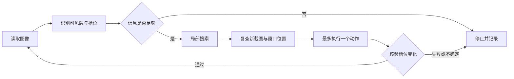

# 羊了个羊视觉自动化实验

一个本地运行的 Python 实验项目：识别窗口中的可见牌面，用局部搜索选择动作，再检查动作前后的槽位变化。适合研究**部分可观测三消、视觉识别与鼠标执行之间的核验闭环**。

**这不是保证通关的外挂，也不是即开即用的完整游戏适配包。** 本仓库不含游戏截图、图案模板或游戏本体；离线演示可直接运行，真实窗口模式需要自行提供有权使用的素材并完成标定。隐藏牌数量与层级未知，不声称第二关已通关。

## 亮点

- 使用模板相似度与绝对颜色差联合过滤，避免单纯相似度把暗牌当成可点击牌；同位置标签冲突时放弃识别。
- 可配置牌面尺度候选，在窗口尺寸不变而图案缩小时重新拟合；遮挡几何随尺度调整，识别不到明牌与探索风险暂停分开报告。
- 七格槽位、三张消除的局部搜索；探索隐藏牌为可选实验功能，默认关闭。
- 点击前检查窗口身份、位置、前台状态及新截图；动作结果不确定时保留待核验记录，不自动重复点击。
- 无需 Codex、浏览器扩展、云端识别、账号或 API 密钥。
- 提供完全自造图案的离线演示与测试，不依赖原项目私有素材。

下图为流程示意，不是游戏界面或实测结果：



## 前置条件

- 验证环境：Windows、Python 3.11；其他 Python 版本未逐一验证。
- 离线演示使用 NumPy、OpenCV、Pillow。真实窗口执行仅支持 Windows，图形界面还需要 Tkinter。
- 真实执行需要可见、无遮挡的目标窗口与自行准备的本机标定、图案模板。不要在有其他鼠标操作的同时运行。

## 安装与离线运行

在仓库目录打开 PowerShell：

```powershell
py -3.11 -m venv .venv
.\.venv\Scripts\python.exe -m pip install -r requirements-dev.txt
.\.venv\Scripts\python.exe demo.py
.\.venv\Scripts\python.exe -m pytest -q
```

演示会用合成画面完成 3 次“识别→决策→核验”，输出 `verified_steps: 3`、空槽位与 `real_input_sent: false`。它不查找窗口、不移动鼠标，也不代表真实游戏通关率。

可选保存合成示例，输出目录必须不存在：

```powershell
.\.venv\Scripts\python.exe demo.py --output demo-output
```

## 准备真实窗口模式

先阅读 [本机标定说明](docs/calibration.md)。仅复制配置骨架，**不能把示例参数视为已校验配置**：

```powershell
New-Item -ItemType Directory -Path local/templates -Force
Copy-Item calibration.example.json local/calibration.json
```

把自己有权使用、适合当前界面的 PNG 图案放到 `local/templates/`。保持 `ready_for_input: false`，先执行离线检查：

```powershell
.\.venv\Scripts\python.exe desktop_app.py --self-check
.\.venv\Scripts\python.exe inspect_frame.py --image local/frame.png --output local/inspection-1
.\.venv\Scripts\python.exe desktop_app.py --locate-only
```

`--self-check` 只验证配置和文件能否加载，不证明识别准确；`--locate-only` 只定位窗口，不激活或点击。离线检查图必须符合配置中的尺寸，详见标定说明。

人工检查多个独立画面的识别结果后，才可在本机配置中设置 `ready_for_input: true`。图形界面默认最多点击 1 次，并在启动时二次确认：

```powershell
.\.venv\Scripts\python.exe desktop_app.py
```

命令行真实输入还必须显式传入 `--allow-input`：

```powershell
.\.venv\Scripts\python.exe desktop_app.py --headless --allow-input --max-steps 1 --max-seconds 60
```

需要实验性探索时再添加 `--explore`。按 **F8 / Esc**、点击界面“停止”，或在本次会话目录创建 `STOP` 文件可停止后续输入。急停无法撤销已经发出的输入。不要把程序用于无人值守或需要保证零误操作的场景。

## 目录结构

```text
demo.py                    自造画面的离线演示
synthetic.py               可重复生成的测试图案与场景
inspect_frame.py           单张图像离线检查，不操作桌面
model.py                   槽位规则、局部搜索、动作核验
vision.py                  模板识别与标注
occlusion.py               未校准的遮挡几何估计
exploration.py             有限探索策略
stability.py               连续画面稳定性判断
configuration.py           本机配置和模板检查
standalone_runner.py       单动作执行及核验循环
windows_driver.py          Win32 窗口检查、截图与输入
desktop_app.py             图形界面及命令行入口
calibration.example.json   禁止真实输入的配置骨架
tests/                     合成场景及模拟驱动测试
docs/calibration.md        标定与素材边界说明
local/                     自备素材和私有配置，Git 忽略
standalone_sessions/       私有运行记录，Git 忽略
```

## 验证方式

```powershell
.\.venv\Scripts\python.exe -m pytest -q
.\.venv\Scripts\python.exe -m compileall -q -x .venv .
.\.venv\Scripts\python.exe demo.py
```

测试覆盖三消规则、未知槽位暂停、合成图案识别、牌面缩放与尺度缓存重拟合、暗牌拒绝、动作核验、遮挡估计、窗口位移取消、过期截图拒绝、结果不确定时不重试、标定与真实输入开关。桌面输入测试使用模拟对象，不连接真实游戏。缩放回归使用自造噪声图案，不包含原游戏实测截图。

命令行发生执行异常、留有待核验动作或点击与核验数量不一致时返回非零状态。正常停止不等于通关；请同时检查会话摘要的 `reason`、`failed`、`pending` 与 `level_clear_verified`。当前版本始终不自行宣称通关。

## 已知限制

- 只根据已识别的可见牌决策，不知道完整牌堆；缺失模板仍可能漏检。槽位完整性检查依赖亮度与颜色启发式，不能证明不存在未知牌。
- 遮挡“概率”是未校准几何先验，不是统计保证；探索可能让局面变差。
- 模板、颜色阈值、基准 19 像素网格和部分遮挡几何与原型布局有关。尺度拟合假设一帧的牌面尺度基本一致，不保证混合尺寸或任意布局的准确率；皮肤、窗口装饰或游戏版本变化仍可能需要重新标定甚至改代码。
- 不支持通用跨游戏识别、联网数据接口或绕过访问控制。窗口执行只适用于本人有权操作的环境。
- 本发布副本只做离线及模拟驱动测试，未进行真实游戏回归、通关率测量、GUI 人工验收或独立 EXE 验证。仓库不分发 EXE，也未保留原打包脚本。
- 运行记录包含窗口截图、坐标及本机路径，默认仅保存在本机；不要直接提交或分享整个会话目录。

## 来源日期与许可证 / 所有权状态

核心 Python 原型形成于 **2026-10-16**；独立发布副本整理于 **2026-10-17**。公开范围为个人项目中形成的代码，以及新编写的配置校验、合成测试和文档；不包含私人对话、原工作流记录、原 Git 历史、第三方游戏截图、图案素材或运行日志。

**2026-10-18** 同步同一原型的牌面缩放修复，并新增合成回归验证；保留发布副本的本机标定确认、显式输入许可、探索默认关闭及错误退出机制，没有引入原项目的素材、打包产物或实测结果。

**当前没有添加开源许可证。** 仓库公开不等于获得任意使用、修改或再分发授权；有关代码许可请联系仓库所有者确认。第三方依赖由各自许可证约束，需另行安装；游戏名称、界面和图案权利属于相应权利人。本项目不是官方产品，也不提供游戏素材的再分发授权。
